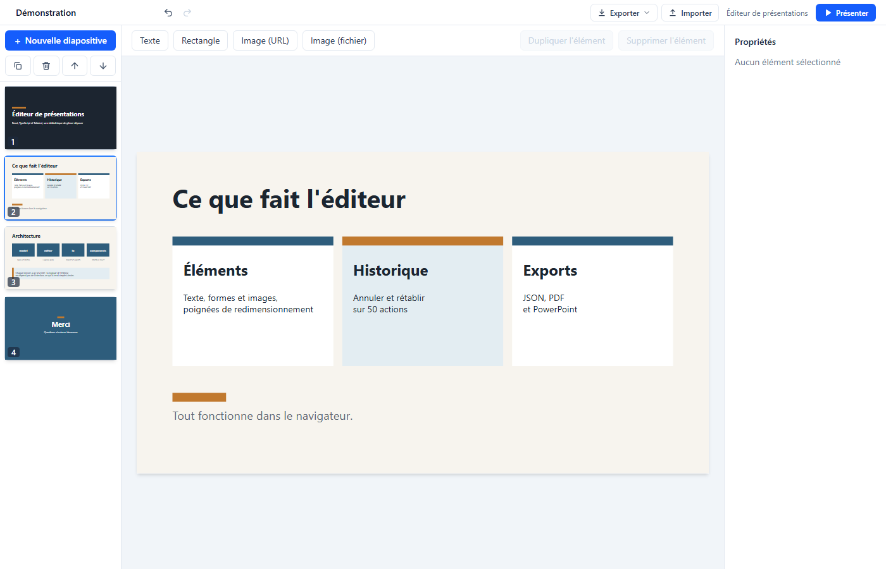
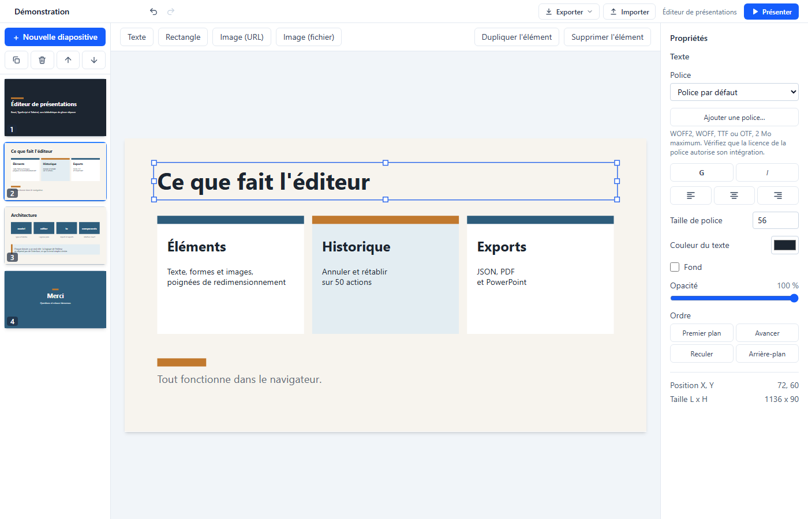
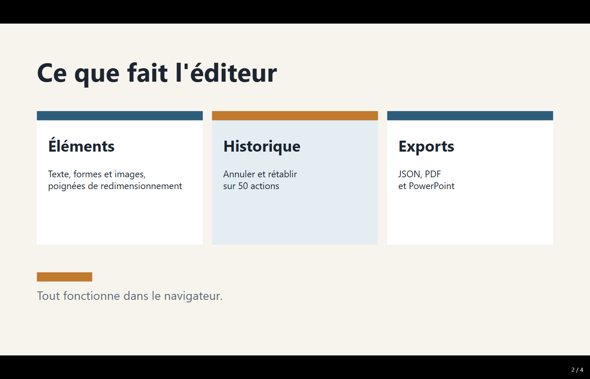
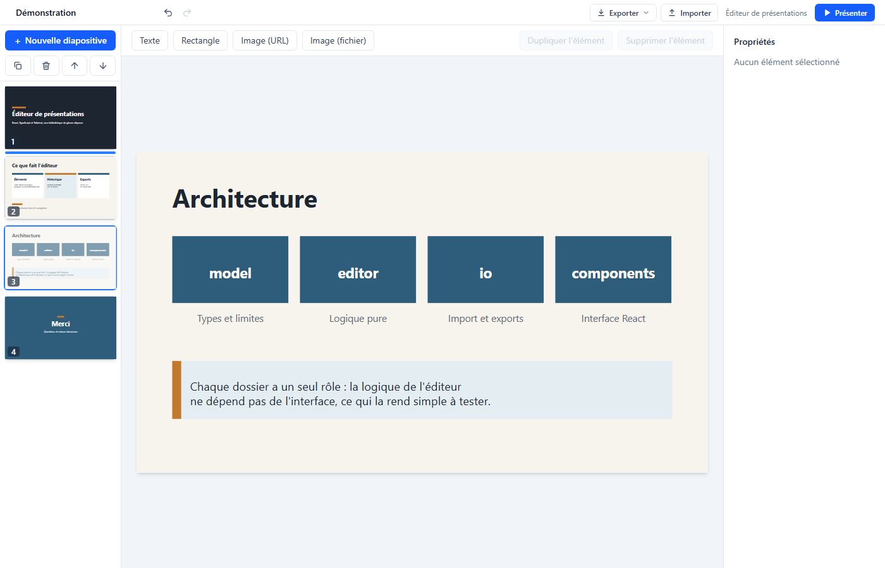

# Éditeur de présentations

Éditeur de présentations dans le navigateur, dans l'esprit de PowerPoint : on compose des diapositives avec du texte, des rectangles et des images, on les réorganise, on les présente en plein écran, et on les enregistre dans un fichier JSON ou on les exporte en PDF ou en PowerPoint. Tout tourne côté client, sans serveur ni compte.

Projet personnel de Tanguy Horard, présenté dans son [portfolio](https://portfolio-tanguy-theta.vercel.app/projets/editeur-presentations).

Réalisé avec l'assistance de Claude Code (agents de développement et de relecture) : voir la section « Méthode de travail » de [docs/DECISIONS.md](docs/DECISIONS.md).

**En bref**
- **Stack** : React 19, Vite 8, TypeScript strict, Tailwind CSS 4, tests Vitest. Un seul ajout d'exécution en plus de React : PptxGenJS, chargée à la demande au premier export PowerPoint.
- **Vérifié** : 65 fichiers de test, 2168 tests qui passent. Un vrai PDF (avec Edge) et un vrai .pptx (ouvert dans LibreOffice Impress) ont été produits et regardés à la main.
- **Pas vérifié** : PowerPoint lui-même, Firefox, Safari, Google Slides, Keynote.
- **Limites** : voir la liste des [limites connues](#limites-connues).

## Aperçu



*L'éditeur : les vignettes à gauche, la diapositive au centre, les propriétés à droite.*



*Un texte sélectionné : ses poignées de redimensionnement et son panneau de propriétés.*



*Le mode présentation : la diapositive en grand, avec le compteur en bas à droite.*



*Réordonner en glissant une vignette : la barre bleue montre où elle va tomber.*

## Fonctionnalités

**Diapositives**
- Mise en page en trois zones : vignettes à gauche, zone d'édition au centre, panneau de propriétés à droite.
- Ajouter, supprimer, dupliquer une diapositive.
- Réordonner : boutons Monter / Descendre, ou glisser une vignette à la souris (une barre indique la position d'arrivée).

**Éléments**
- Trois types : texte, rectangle, image.
- Une image s'ajoute par adresse (URL http ou https) ou depuis un fichier local (2 Mo au maximum, intégré au fichier de la présentation sous forme de data URL).
- Déplacement à la souris et redimensionnement par 8 poignées (4 coins, 4 côtés). L'élément reste toujours dans la diapositive.
- Édition du texte en ligne par double-clic.
- Dupliquer un élément (bouton ou Ctrl+D).
- Déplacer l'élément sélectionné aux flèches du clavier (1 unité, 10 avec Maj).

**Panneau de propriétés**
- Texte : police (8 polices courantes, une police ajoutée par fichier, ou une police installée sur l'ordinateur si le fichier en nomme une autre), gras, italique, alignement (gauche, centre, droite), taille de police, couleur du texte, fond optionnel et sa couleur.
- Rectangle : couleur de remplissage.
- Image : texte alternatif.
- Ajouter sa propre police (WOFF2, WOFF, TTF, OTF) : bouton « Ajouter une police… » sous le choix de la police d'un texte. Le fichier (2 Mo au maximum, 10 polices au plus) est intégré à la présentation, enregistré dans le navigateur avec l'API `FontFace`, proposé dans le groupe « Mes polices » et appliqué au texte sélectionné. L'ajout est une seule entrée d'historique : un Ctrl+Z retire la police et rend l'ancienne. La police voyage dans le fichier JSON et dans le PDF, pas dans le PowerPoint (voir les limites connues).
- Tous les éléments : opacité, ordre d'empilement (premier plan, avancer, reculer, arrière-plan).
- Rappel en lecture seule de la position et de la taille.

**Historique et fichiers**
- Annuler / rétablir, sur 50 actions.
- Mode présentation : diapositive plein écran, navigation au clavier ou au clic.
- Export de la présentation en fichier JSON, import d'un fichier JSON (validé, annulable).
- Export en PDF (via l'impression du navigateur : choisir « Enregistrer au format PDF »).
- Export PowerPoint (.pptx) : un vrai fichier modifiable (zones de texte, formes, images), prévu pour PowerPoint, LibreOffice Impress, Google Slides et Keynote (seul LibreOffice Impress a été essayé, voir les limites connues). Les images sont converties en PNG si besoin (PowerPoint ne lit pas le WebP), l'opacité devient la transparence PowerPoint, et les cas qui n'ont pas pu être traduits (image distante bloquée, couleur inconnue) sont listés dans le message de fin d'export.
- Titre de la présentation éditable (il donne aussi le nom du fichier exporté).

## Quel format d'export choisir ?

Le menu Exporter propose trois formats, qui ne servent pas à la même chose.

| Format | À utiliser pour | À savoir |
| --- | --- | --- |
| JSON | Sauvegarder son travail et le rouvrir plus tard : c'est le format d'enregistrement. | Se rouvre uniquement dans cet éditeur (bouton Importer). Contient tout, y compris les images et les polices ajoutées. |
| PDF | Présenter ou envoyer la présentation. | Le texte et les polices utilisées sont intégrés (vu dans Edge ; dépend du navigateur). Il passe par la boîte d'impression du navigateur : choisir « Enregistrer au format PDF » comme imprimante (le Ctrl+P natif n'imprime rien). Il ne se modifie pas. |
| PowerPoint (.pptx) | Continuer à modifier la présentation dans PowerPoint, Google Slides, Keynote ou LibreOffice Impress, le logiciel gratuit équivalent de PowerPoint (seul LibreOffice Impress a été essayé). | Rendu proche de l'écran mais pas identique. Les polices doivent être installées sur l'ordinateur qui ouvre le fichier (celles ajoutées dans l'éditeur n'y sont pas intégrées). Pas d'export .odp natif : dans LibreOffice Impress, ouvrir le .pptx puis « Enregistrer sous » au format ODP. |

## Raccourcis clavier

Les raccourcis de l'éditeur sont lus dans `src/hooks/useKeyboardShortcuts.ts`. Sur macOS, Cmd remplace Ctrl. Ils sont suspendus en mode présentation, pendant l'impression du PDF, et ne volent pas les touches quand on tape dans un champ de texte (le navigateur garde alors son propre annuler).

| Touche | Action |
| --- | --- |
| Suppr ou Retour arrière | Supprimer l'élément sélectionné (pas quand on tape dans un champ, pas en touche maintenue) |
| Ctrl+Z | Annuler |
| Ctrl+Maj+Z ou Ctrl+Y | Rétablir |
| Ctrl+D | Dupliquer l'élément sélectionné (une copie par appui, pas par répétition) |
| Flèches | Déplacer l'élément sélectionné de 1 unité |
| Maj+flèches | Déplacer l'élément sélectionné de 10 unités |
| Ctrl+Entrée (dans l'édition du texte) | Valider le texte |
| Échap (dans l'édition du texte) | Annuler la saisie |
| Échap (pendant un déplacement, un redimensionnement ou un glisser de vignette) | Abandonner le geste |

Le texte en cours d'édition est aussi validé quand le champ perd le focus ou quand on clique ailleurs.

**Mode présentation** (`src/components/presentation/navigation.ts`) :

| Touche | Action |
| --- | --- |
| Flèche droite, flèche bas, Page suivante, Entrée, Espace | Diapositive suivante |
| Flèche gauche, flèche haut, Page précédente, Retour arrière, Maj+Espace | Diapositive précédente |
| Début | Première diapositive |
| Fin | Dernière diapositive |
| Échap | Quitter la présentation |
| Clic gauche | Diapositive suivante |

Aux bornes, la navigation s'arrête (pas de retour au début). Les combinaisons avec Ctrl, Alt ou Cmd sont laissées au navigateur.

## Lancer en local

Prérequis : Node 22.22.2 ou plus récent, hors Node 23, hors Node 25 et hors Node 24 avant 24.15 (contrainte de jsdom 30, utilisé par les tests). Le projet est développé avec Node 24.18. Vite 8 et ESLint 10 accepteraient Node 20.19, mais pas les tests.

```bash
git clone https://github.com/Takanaguy/editeur-presentations.git
cd editeur-presentations
npm install
npm run dev
```

Vite sert l'application sur http://localhost:5173 (port par défaut, il en prend un autre s'il est occupé).

## Tests, lint, build

Depuis la racine du projet :

| Commande | Rôle | Résultat constaté à la rédaction |
| --- | --- | --- |
| `npm test` | Lance tous les tests une fois (`vitest run`) | 65 fichiers, 2168 tests, tous passent |
| `npm run test:watch` | Relance les tests à chaque modification | (mode interactif, non lancé pour ce relevé) |
| `npm run lint` | ESLint sur tout le projet | aucune erreur ni avertissement |
| `npm run build` | Vérification des types (`tsc -b`) puis build de production dans `dist/` | réussi, 74 modules. JavaScript principal de 295,6 ko (91,1 ko en gzip), plus deux fichiers chargés seulement au premier export PowerPoint : le code d'export (10,9 ko, 5,2 ko en gzip) et PptxGenJS (368,4 ko, 123,2 ko en gzip). Un troisième fichier de 0,09 ko remplace un module Node inutile dans le navigateur |
| `npm run preview` | Sert le contenu de `dist/` pour le vérifier avant déploiement | (serveur, non lancé pour ce relevé ; la commande est présente dans `package.json`) |

`npm run dev` et `npm run preview` sont des serveurs : leur présence a été vérifiée dans `package.json`, pas leur exécution.

## Limites connues

- **Un seul navigateur essayé en vrai** (Microsoft Edge). PowerPoint, Google Slides, Keynote, Firefox et Safari n'ont pas été testés.
- **PDF** : le Ctrl+P natif n'imprime rien (utiliser Exporter puis PDF). Le rendu d'impression n'est pas dans la suite de tests ; il a été vu une fois dans Edge.
- **PowerPoint** : rendu proche de l'écran mais pas identique (polices installées sur le poste, coupures de lignes, interligne). Le .pptx n'a été ouvert que dans LibreOffice Impress. Pas d'export .odp natif.
- **Polices ajoutées** : pas de suppression (seulement Ctrl+Z), pas intégrées au fichier PowerPoint, licence à la charge de l'utilisateur.
- **Rien n'est conservé si on recharge la page** : exporter en JSON pour garder son travail.
- **Pas de mobile ni de petits écrans** ; le glisser des vignettes est désactivé au toucher.
- **Clavier et accessibilité** : redimensionnement à la souris seulement, pas d'annonce aux lecteurs d'écran après annuler / rétablir.
- **Pas de ratio verrouillé ni de guides d'alignement.**
- **Le vrai plein écran n'a pas été vérifié** (simulé par les tests), et la performance avec de très grosses présentations n'a pas été mesurée.
- **Format** : une seule version (`version: 1`), sans migration. Une image par adresse disparaît si le site distant disparaît.

Détails : [docs/DECISIONS.md, section « Limites connues »](docs/DECISIONS.md#limites-connues).

## Stack

- React 19 et Vite 8
- TypeScript 6 en mode strict (`strict`, `noUncheckedIndexedAccess`)
- Tailwind CSS 4 (plugin Vite)
- Vitest 5, React Testing Library, user-event et jsdom pour les tests
- ESLint 10 avec typescript-eslint et eslint-plugin-react-hooks
- PptxGenJS 4 (licence MIT) pour écrire le fichier .pptx

Aucune bibliothèque pour le glisser-déposer, l'état ou la validation : tout est écrit dans le projet. Les dépendances d'exécution déclarées dans `package.json` sont `react`, `react-dom` et `pptxgenjs`. PptxGenJS est chargée à la demande (import dynamique, au premier export PowerPoint) : elle est dans un fichier à part et n'alourdit pas le chargement de l'application. `jszip` est déclarée en devDependency parce que les tests relisent l'archive .pptx produite ; PptxGenJS l'utilise aussi de son côté et l'installe elle-même. Un `overrides` dans `package.json` impose `image-size` 2.0.3 ou plus (une dépendance de PptxGenJS, utilisée sous Node seulement et absente du navigateur) : à la rédaction, `npm audit` affiche 0 vulnérabilité.

## Architecture

```
editeur-presentations/
├── index.html, vite.config.ts (Vite, Tailwind, Vitest avec jsdom), eslint.config.js
├── docs/                   DECISIONS.md (choix techniques et difficultés), screenshots/ (captures du README)
└── src/
    ├── main.tsx, App.tsx, index.css   point d'entrée, composant racine, styles globaux (dont l'impression)
    ├── model/              données pures : types, fabriques, ids, type guards, limites, polices (fonts.ts, fontFormats.ts)
    ├── editor/             logique d'édition pure
    │   ├── reducer.ts          aiguillage des actions (switch exhaustif) vers slideOps.ts, elementOps.ts,
    │   │                       presentationOps.ts (charger, renommer) et fontOps.ts (ajouter une police, fontBlockReason)
    │   ├── geometry.ts         bornes, déplacement, redimensionnement, index de dépôt
    │   ├── history.ts          annuler / rétablir (snapshots)
    │   ├── addLimits.ts        règle unique pour refuser un ajout
    │   └── state.ts, types.ts  état initial, types de l'état et des actions (et testHelpers.ts, aides des tests)
    ├── io/                 entrées et sorties
    │   ├── presentationJson.ts   validation, import, export JSON
    │   ├── pptxExport.ts         export PowerPoint : plan pur (pouces, points) puis écriture avec PptxGenJS
    │   ├── pptxImages.ts, cssColor.ts   images en PNG via un canvas ; couleur CSS vers hexadécimal PowerPoint
    │   ├── fontFile.ts, fontLoader.ts   lire un fichier de police (extension, taille, signature) ; le charger (FontFace)
    │   └── imageUrl.ts, imageSize.ts, imageElement.ts, readImageFile.ts, readTextFile.ts, download.ts
    ├── hooks/              branchement de la logique sur React
    │   ├── EditorProvider.tsx, EditorContext.ts, useEditor.ts   le store
    │   ├── useElementGesture.ts, useThumbnailDrag.ts, useElementSize.ts   déplacer et redimensionner, glisser les vignettes, mesurer
    │   └── useKeyboardShortcuts.ts, useDocumentFonts.ts   raccourcis ; document.fonts synchronisé avec les polices de la présentation
    ├── components/         interface : layout (EditorLayout, seul composant relié au store), canvas, thumbnails,
    │                       toolbar (menu Exporter), properties, presentation, print (vue d'impression du PDF)
    └── test/               aides de test partagées (setup, fixtures, événements de pointeur, disposition simulée, fausses polices)
```

Les tests sont placés à côté du code qu'ils vérifient (`*.test.ts` et `*.test.tsx`).

**Règles de dépendances** (respectées dans le code actuel) :
- `model/`, `editor/` et `io/` n'importent jamais React. Leur logique se teste sans interface.
- Les composants de présentation (canvas, vignettes, barres d'outils, propriétés, mode présentation) reçoivent des données et des fonctions par leurs props, et ne contiennent pas de logique métier. Ils n'utilisent que des hooks d'interface (`useElementGesture`, `useThumbnailDrag`, `useElementSize`), jamais le store.
- Seul `EditorLayout` est connecté au store (`useEditor`). Il lit l'état, répartit des props et envoie les actions.

## Format du fichier JSON

L'export produit un fichier JSON indenté, de cette forme (exemple raccourci) :

```json
{
  "version": 1,
  "title": "Ma présentation",
  "fonts": [
    {
      "name": "Fira Code",
      "src": "data:font/woff2;base64,d09GMgABAAAAA..."
    }
  ],
  "slides": [
    {
      "id": "d4f1c2a0-0000-4000-8000-000000000001",
      "elements": [
        {
          "id": "d4f1c2a0-0000-4000-8000-000000000002",
          "type": "rect",
          "x": 440, "y": 240, "width": 400, "height": 240,
          "opacity": 1,
          "fill": "#2e5d7c"
        },
        {
          "id": "d4f1c2a0-0000-4000-8000-000000000003",
          "type": "text",
          "x": 340, "y": 300, "width": 600, "height": 120,
          "opacity": 1,
          "text": "Bonjour",
          "fontSize": 48,
          "color": "#ffffff",
          "fill": null,
          "bold": true,
          "italic": false,
          "align": "center",
          "fontFamily": "Georgia"
        }
      ]
    }
  ]
}
```

(Le fichier réel n'a pas de commentaires, JSON n'en accepte pas. Les explications sont ci-dessous.)

- **`version`** : toujours `1`. Il sert à reconnaître le format pour pouvoir migrer d'anciens fichiers plus tard. Aujourd'hui, toute autre valeur est refusée.
- **`title`** : texte, nettoyé des espaces en début et fin, tronqué à 200 caractères (sans erreur). S'il est absent, l'import met « Sans titre ».
- **`fonts`** (facultatif, absent = aucune police ajoutée) : tableau de 10 polices au plus, chacune avec un `name` et un `src`. Le `name` suit la règle des noms de police (voir `fontFamily` ci-dessous), ne peut pas être celui d'une des 8 polices courantes (casse ignorée) et doit être unique dans le fichier (casse ignorée). Le `src` est une data URL en base64 de la forme `data:font/woff2;base64,...` (aussi `font/woff`, `font/ttf`, `font/otf`), de 3 Mo de caractères au plus, 8 Mo cumulés pour toutes les polices. Les premiers octets décodés doivent correspondre au format annoncé (WOFF2, WOFF, TrueType ou OpenType) : ce contrôle de surface écarte les fichiers qui n'ont rien d'une police, mais la vraie validation est faite par le navigateur quand il charge la police. Un texte peut utiliser une de ces polices en la nommant dans `fontFamily`. Voir `docs/DECISIONS.md`, décision 13.
- **`slides`** : au moins 1 diapositive, 200 au maximum. Chacune a un `id` et une liste `elements`.
- **L'ordre de `elements` est l'ordre d'empilement** : le dernier élément est au premier plan. Il n'y a pas de champ `z-index`.
- **Champs communs** à tous les éléments : `id`, `type` (`"text"`, `"rect"` ou `"image"`), `x`, `y`, `width`, `height` (espace logique 1280 x 720) et `opacity` (de 0 à 1, facultatif, 1 par défaut).
- **Texte** : `text` (10 000 caractères au maximum), `fontSize` (de 8 à 400) et `color` sont obligatoires ; `fill` (couleur ou `null`), `bold`, `italic`, `align` (`"left"`, `"center"`, `"right"`) et `fontFamily` sont facultatifs, avec pour défauts `null`, `false`, `false`, `"left"` et `null`.
- **`fontFamily`** (texte seulement) : un NOM de famille de police (`"Georgia"`, `"Calibri"`), jamais une valeur CSS. `null` (ou absent) veut dire la police par défaut de l'application. Le nom est limité à 64 caractères : lettres sans accent, chiffres, espaces, tirets bas et tirets, en commençant et en finissant par une lettre ou un chiffre, sans deux espaces de suite (« Fira Code » passe, « Gill Sans (MT) » et « Arial » suivi d'un espace sont refusés). La comparaison avec la liste des polices courantes tient compte de la casse. Tout autre contenu est refusé à l'import (voir `docs/DECISIONS.md`, décision 12).
- **Rectangle** : `fill` (couleur, obligatoire).
- **Image** : `src` (obligatoire : adresse http, https ou data URL `data:image/`), `alt` (facultatif, 500 caractères au maximum, vide par défaut).
- **Couleurs** : hexadécimal (3, 4, 6 ou 8 chiffres), un mot de 1 à 30 lettres (par exemple `red`, sans vérification de la liste des couleurs CSS), ou `rgb()`, `rgba()`, `hsl()`, `hsla()`.

**Limites** (valeurs lues dans `src/model/limits.ts`, `src/io/presentationJson.ts` et `src/io/readImageFile.ts`) :

| Limite | Valeur |
| --- | --- |
| Taille du fichier à l'import et à l'export | 25 Mo |
| Diapositives par présentation | 200 |
| Éléments par diapositive | 500 |
| Caractères par texte | 10 000 |
| Caractères par nom de police | 64 |
| Polices ajoutées par présentation | 10 |
| Police ajoutée depuis un fichier local | 2 Mo |
| Une police par fichier JSON importé | 3 Mo de caractères de `src` |
| Poids cumulé des polices de la présentation | 8 Mo de caractères de `src` |
| Poids cumulé des images de la présentation (appliqué à l'ajout ou à la copie d'un élément image) | 15 Mo de caractères de `src` |
| Image ajoutée depuis un fichier local | 2 Mo |
| Une image par fichier JSON importé | 4 Mo de caractères de `src` |

La géométrie hors limites (par exemple un élément qui dépasse de la diapositive) est ramenée dans les bornes à l'import plutôt que refusée. Les erreurs de structure sont refusées avec un message en français qui indique la diapositive et l'élément concernés. Détails dans `docs/DECISIONS.md`.

## Déploiement sur Vercel

Le projet est à la racine de son dépôt `editeur-presentations`.

1. Sur vercel.com, cliquer sur « Add New » puis « Project », et importer le dépôt `editeur-presentations`.
2. Vercel détecte le preset « Vite ». Vérifier : commande de build `npm run build`, dossier de sortie `dist`, commande d'installation par défaut. Version de Node : 22 ou plus (le projet est développé avec Node 24). Aucune variable d'environnement n'est nécessaire.
3. Cliquer sur « Deploy ». Ensuite, chaque push sur la branche principale redéploie.
4. Alternative en ligne de commande, à la racine du projet : `npx vercel` (une connexion est demandée), puis `npx vercel --prod` pour la production.

**URL de la démo : à renseigner après le déploiement.** Le déploiement n'a pas encore été fait.

## Hors périmètre volontaire

Pas dans le projet, par choix de périmètre : animations et transitions, thèmes et modèles de mise en page, collaboration en temps réel, sauvegarde automatique (le travail n'est enregistré que par l'export JSON), comptes utilisateurs. L'export PDF en faisait partie au départ : le périmètre a changé à la demande du propriétaire du projet (voir [docs/DECISIONS.md](docs/DECISIONS.md)).

## Pour aller plus loin

Les choix techniques et les difficultés rencontrées sont expliqués dans [docs/DECISIONS.md](docs/DECISIONS.md).

Historique : les premiers commits portent le préfixe `slide-editor`, parce que le projet vivait d'abord dans le dépôt de son portfolio avant d'avoir son propre dépôt.
